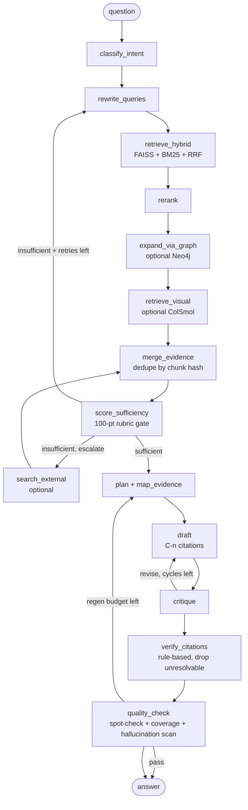

# Evidence — Local-First, Evidence-Gated Agentic RAG

An implementation of the evidence-gated, multimodal agentic RAG architecture built on top of *arXiv:2606.01613*.
Evidence answers research questions over a local
corpus of technical literature (PDF / LaTeX / HTML / text) using:

- **LangGraph** for agent orchestration (a deterministic, inspectable state machine),
- **Ollama** local models for reasoning, embedding, and reranking,
- **FAISS + BM25** hybrid retrieval fused with reciprocal rank fusion (RRF),
- **Neo4j** knowledge-graph expansion (optional),
- **OpenAlex / Semantic Scholar / Crossref** external search (optional),
- **ColSmol / CLIP**-style visual page retrieval (optional).

## Core design principle

> The pipeline **never hard-fails** because a small model is unavailable or
> returned prose.

Every model call has a deterministic fallback (BM25-only retrieval, a
heuristic reranker, rule-based generation). **Citation verification is fully
rule-checkable** — we prefer it over LLM judgment. This means Evidence produces
grounded, cited answers even with no LLM and no network at all.

## Using it with a client model (VS Code Copilot / Claude / etc.)

Evidence exposes **tools**, not opinions. When an MCP client (e.g. VS Code
Copilot) is already driving the conversation with a capable model, prefer the
**thin tools** and let that client model do the reasoning and writing:

| Tool | Role | Local model? |
|---|---|---|
| `search_corpus` | retrieve ranked, cited chunks | retrieval only |
| `check_evidence` | score the evidence set (100-pt rubric) | **no** (deterministic) |
| `verify_claim` | SUPPORTED / PARTIAL / UNSUPPORTED | **no** (rule-based) |
| `lookup_evidence` / `record_evidence` | read / write the decision ledger | **no** (SQLite) |
| `audit_evidence` / `impact_analysis` / `export_evidence` | ledger health / propagation | **no** (SQLite) |
| `answer_research` | the "full pipeline" — see below | depends on mode |

`answer_research` has two modes, selected by `mcp.prefer_client_generation`:

- **`true` → bundle mode** (recommended when a strong client model is present):
  returns retrieved chunks + a deterministic sufficiency score + explicit
  guidance, and the **client model** synthesises the cited answer. **No local
  generation models are run.**
- **`false` → full mode** (default): runs Evidence's local
  Planner/Writer/Critic and returns a finished answer. Use for **headless**
  runs (scripts, CI) where there is no client model.

```yaml
# config.yaml — recommended when a capable MCP client model is available
mcp:
  prefer_client_generation: true
```

### Do you need to run local models at all?

Only for **dense retrieval** (embeddings) and **cross-encoder rerank** — both
are optional:

- `ollama pull bge-m3` for dense embeddings (small, ~1 GB), or skip it and use
  **BM25-only** retrieval.
- Every `search_corpus` result carries a `retrieval_mode` field
  (`hybrid` | `bm25_only` | `dense_only` | `unavailable`) so you can tell how
  results were produced and why.
- The ledger, `verify_claim`, and `check_evidence` work with **zero** local
  models.

So on a memory-constrained machine the sweet spot is: **client model for
thinking + BM25 (or `bge-m3`) for retrieval + the no-LLM ledger tools**, and you
never run the local 9B/4B generation stack alongside the client model.

## Architecture



Stages (from PLAN.MD): intent classification → query rewrite → hybrid
retrieval → rerank → graph/visual expansion → evidence merge → sufficiency
gate (with retry/escalation loop) → plan + evidence mapping → draft → critique
loop → **citation integrity verification** → QC (citation spot-check, coverage,
hallucination scan) → answer.

## Installation

```bash
# From PyPI (when published), or from a local clone:
pip install evidence                  # core (text loop, BM25/FAISS, CLI)
pip install "evidence[mcp,pdf]"       # + MCP server + PDF extraction
pip install "evidence[all]"           # everything (rerank, pdf, latex, vision, neo4j, mcp, dev)
# Local source install (dev):
git clone <this repo> && cd evidence && pip install -e ".[all]"
```

### Local models (recommended)

```bash
ollama pull bge-m3        # dense embeddings (~1 GB) — needed for hybrid retrieval
ollama pull qwen2.5:4b    # light: rewrite / classify / QC
ollama pull qwen2.5:9b    # reasoning: plan / generate / critique
```

`evidence init` walks you through this interactively and asks for the
**reasoning** model and the **embedding** model as separate choices (defaulting
the embedder to `bge-m3` when it's present).

### Thinking models (qwen3.x, gemma3, deepseek-r1, …)

Thinking models spend their whole token budget on hidden reasoning before
answering. With Ollama's `format: json` that means **empty output** — the
writer silently falls back to an automated draft. Evidence therefore sends
`think: false` to every generation call by default (the option is a no-op on
non-thinking models like `qwen2.5` or `mistral`). If you deliberately want
chain-of-thought, set `ollama.think: true` in your config — and expect the
JSON stages to fall back to deterministic defaults, plus longer runtimes.

### No Ollama / cloud-only LLM

If you only have a cloud LLM provider and no local models, that's fine — you
have two options:

- **Keep BM25-only retrieval** (no embedding model needed). Drop the
  `embed:` line (or point it nowhere) and Evidence indexes with BM25 +
  heuristic rerank. `evidence ask` still works; you'll see
  `retrieval_mode: bm25_only` in the answer envelope.
- **Let the client model do the writing**: set
  `mcp.prefer_client_generation: true` (see
  ["Using it with a client model"](#using-it-with-a-client-model-vs-code-copilot--claude--etc))
  so `answer_research` returns the evidence bundle and your cloud model
  synthesises the cited answer. No local generation models are run at all.

Without any local models, Evidence runs in **fallback mode** (BM25 +
heuristic rerank + rule-based generation) and still returns cited answers.

## Quick start

```bash
# 0. One-command setup (in the project you want Evidence to serve):
#    creates `.evidence/config.yaml`, `corpus/`, `.mcp.json`, updates `.gitignore`
evidence init

# 1. Drop PDF / LaTeX / .html / .md / .txt files into `corpus/` (any depth), then index them:
evidence ingest

#    Note: for a paper saved from arXiv or Google Scholar, save the **PDF**
#    (or the LaTeX source), not the "page as HTML" viewer — the HTML viewer
#    is just an <iframe> wrapper around the PDF and has no extractable text.

# 2. Ask a question — get a cited, QC'd answer (config auto-discovered):
evidence ask "How does the attention mechanism compute soft weighting?"

# 3. Inspect state
evidence status
evidence config
```

`evidence init` is idempotent and safe to re-run with `--yes` to refresh the
templates. Every command after that auto-discovers `.evidence/config.yaml` by
walking up from the current directory, so `-c` is optional. `evidence ingest`
defaults its corpus to `corpus_dir` from the config (or `./corpus`).

## Knowledge graph (Phase 2)

```bash
evidence build-knowledge-graph            # entities + citations + authors (offline)
evidence build-knowledge-graph --load-neo4j   # also load into a running Neo4j
evidence build-knowledge-graph --author-online  # resolve author IDs via OpenAlex
```

## External search (Phase 3)

Enable in config (`external.enabled: true`) or via `EVIDENCE_EXTERNAL_ENABLED=1`.
Respectful of OpenAlex's polite pool (`external.openalex_mailto`) and the
Semantic Scholar rate cap.

## Evaluation (Phase 5)

```bash
evidence eval golden.json -o report.json
```

Reports recall@k, precision@k, MRR, nDCG@k, sufficiency-gate accuracy,
citation faithfulness, answer coverage, and answer rate over a golden set
(JSON array of items or JSONL; see `evidence.eval.golden.GoldenItem`).

## Configuration

All tunables live in a single pydantic model (`evidence.config.EvidenceConfig`):
models, retrieval budgets, chunking, the sufficiency rubric, retry/escalation
budgets, generation temperatures, and feature toggles. Override via YAML or
`EVIDENCE_<SECTION>_<FIELD>` env vars. See [`config.example.yaml`](config.example.yaml).

## Development

```bash
pip install -e ".[dev]"
pytest -q            # unit + end-to-end tests (run offline in fallback mode)
ruff check src tests
```

## Package layout

```
src/evidence/
  config.py            # swappable pydantic config (YAML + env)
  cli.py               # Typer CLI (ingest/ask/status/config/build-kg/eval)
  models/ollama.py     # Ollama facade + deterministic embedder/reranker fallbacks
  ingestion/           # pdf / latex / html / chunker / pipeline / page rendering
  indexes/             # store (SQLite) / FAISS / BM25 / hybrid Retriever + RRF
  graph/               # LangGraph state + nodes + builder (the agent)
  external/            # OpenAlex / Semantic Scholar / Crossref + backoff
  kg/                  # knowledge-graph: entities, citations, authors, Neo4j
  eval/                # metrics, golden set, faithfulness, runner
tests/                 # offline unit + e2e tests
```